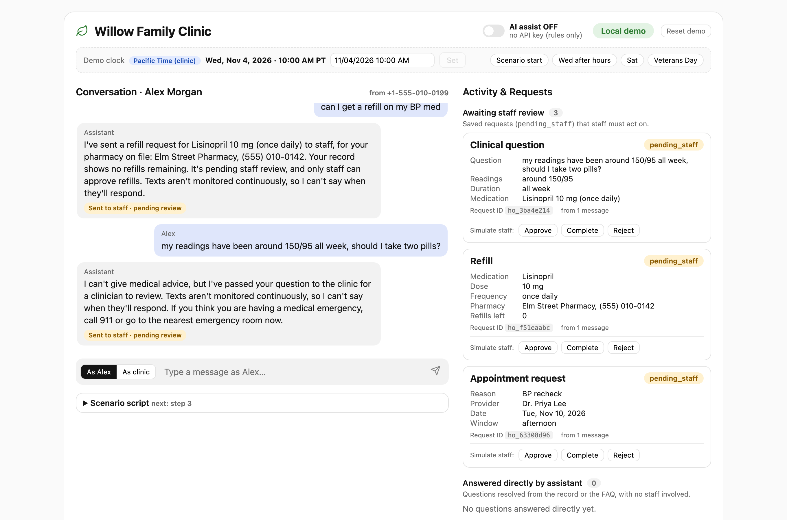
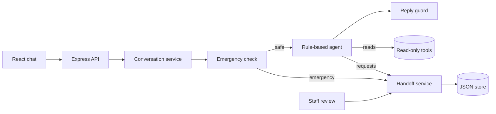

# Agentic Chat with Guardrails

A patient messaging assistant that answers what its data can answer and turns everything else into a
**structured request a human can act on**, without having to ask the user again.

**React · TypeScript · Express · Vitest** · runs locally with no API keys or database



*The clinic, the patient and all data are fictional.*

## Highlights

- **Human in the loop.** The assistant files typed, validated, deduplicated requests. Only staff can approve them.
- **Safety as a wrapper.** An emergency check runs before the agent and a reply guard runs after it, whatever agent is plugged in.
- **Least privilege.** The agent's tools are read-only, and one separate code path creates or changes requests.
- **Explicit conversation state.** A bare "yes" is matched to the question it answers, even after a restart.
- **Evals with a hard safety gate.** Any safety miss fails the run.
- **Rules first, LLM optional.** The agent is deterministic by default. An optional OpenAI assist only *classifies* messages the rules don't understand. It never writes replies and never sees the patient record.

## Example

| User says | The assistant | Staff receive |
|---|---|---|
| "can I get a refill on my BP med" | Confirms it was sent for review, not approved | Medication, dose, frequency, pharmacy, refills left |
| "my readings have been around 150/95 all week, should I take two pills?" | Declines to give medical advice | The question, readings, duration, related medication |
| "I have chest pain and my left arm feels numb" | Replies with a fixed emergency message | An emergency record with the detected signals |
| "what time do you close today?" | Answers from the clinic FAQ | Nothing, no staff needed |

## How it works



## Run it

Requires Node 20+.

```bash
npm install
npm run dev        # open http://localhost:5173
```

Use the **Scenario script** panel under the chat to play a 12-step demo, or type your own messages.

| Command | What it does |
|---|---|
| `npm test` | Unit and end-to-end tests |
| `npm run eval` | Eval scorecard: safety, correctness, staff follow-ups, context use, stability |
| `npm run scenario` | Runs the demo script and variations, and regenerates the [evidence report](docs/evidence.md) |
| `npm run typecheck` | TypeScript checks |

To try the optional AI assist, copy `.env.example` to `.env`, add your `OPENAI_API_KEY`, and switch it on in the UI.

## Testing and evals

- **587 tests** (552 API, 35 web).
- **30 eval cases, 3 runs each**, in rules-only mode: all pass the safety gate and behave as expected.
- Scoring uses exact assertions instead of an LLM judge, so results are reproducible.

These cases were written by the same author as the agent. They show it handles those situations, not every possible phrasing.

## Key decisions

| Decision | Why | Trade-off |
|---|---|---|
| Rules and templates by default | Safety-critical replies don't depend on a model | Limited language coverage |
| Emergency detection leans toward false alarms | A miss costs far more than an extra warning | Some harmless messages trigger it |
| A follow-up message updates the open request | Staff don't get duplicates | Two similar requests would be merged |
| JSON file storage | Zero setup | Single process only |

## Limitations and next steps

This is a local demo, not a medical product. The rules are English-focused (minimal Spanish emergency patterns), the
emergency detector can miss phrasings, and there is no identity verification. Next: broader evaluation of the AI
assist, then identity verification and a real database.

More in the [design notes](docs/details.md).
